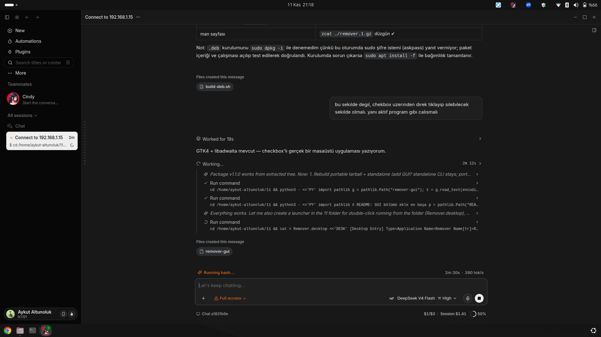

# remover

**English** · [Türkçe](README.tr.md) · [中文](README.zh.md)

A tiny, dependency-free uninstaller for Ubuntu/Debian. It lists everything you have installed —
APT applications, Snap packages, Flatpak apps, Docker images, AppImage files and desktop shortcuts —
then lets you **tick checkboxes and remove the selected items in one go**.



```
┌──────────────────────────────────────────────────────────────┐
│ ⟳   Remover                                                  │
│     114 items · 76 removable · 26.0 GB                       │
├──────────────────────────────────────────────────────────────┤
│ [ Search programs…        ]  [Select all]   [Clear]          │
│ ▸ APT applications                                           │
│   ☐ zoom            Zoom Workplace                     APT   │
│   ☐ qoder-ide       Agentic Coding Platform            APT   │
│ ▸ Snap packages                                              │
│   ☐ android-studio  3.1 GB                            SNAP   │
│   ☐ snapd           snapd 2.77.1        protected ⛔   SNAP   │
├──────────────────────────────────────────────────────────────┤
│ 2 items selected · ~1.7 GB          (⟳)  [Remove selected]   │
└──────────────────────────────────────────────────────────────┘
```

## Why

Removing software on Linux means remembering whether it came from `apt`, `snap`, `flatpak`,
`docker`, or a loose `.AppImage`. `remover` scans every source, shows one numbered/checkable list
with real disk sizes, and executes the right command for each item — behind a single confirmation.

## Features

- **GTK4 + libadwaita GUI** (`remover-gui`): checkbox list, search filter, select-all/clear,
  live size totals, log console, one polkit/sudo prompt for the whole batch.
- **CLI** (`remover`): numbered list with range selection (`1,4,10-15`, `all`), `--dry-run`, `--json`.
- **Six sources**: APT (manually installed apps), Snap, Flatpak, Docker images, AppImages, `.desktop` shortcuts.
- **Protected packages** (`/etc/remover/remover.conf`): system, desktop, and infrastructure packages
  (apache2, mysql, postgresql, php, docker, tailscale, cloudflared, git, node…) can never be removed
  by accident — shown with a red `protected` label and disabled checkbox.
- **Runtime awareness**: snap runtimes (`core22`, `gnome-4x`, `mesa-*`, `wine-platform*`) are tagged
  `runtime` so you know what other snaps depend on.
- **Safe by design**: explicit confirmation, dry-run mode, per-run logs in
  `~/.local/state/remover/`, no hidden deletion of user data.
- **No Python dependencies** beyond the standard library (GUI needs PyGObject, which ships with Ubuntu).

## Install

### .deb package (recommended)

```bash
# download remover_1.1.0_all.deb from Releases, then:
sudo apt install ./remover_1.1.0_all.deb
```

Dependencies are resolved automatically (`python3`, `python3-gi`, `gir1.2-gtk-4.0`, `gir1.2-adw-1`).
The package installs `/usr/bin/remover`, `/usr/bin/remover-gui`, `/etc/remover/remover.conf`,
a man page and a desktop entry (application menu → **Remover**).

### Portable (no installation)

```bash
tar -xzf remover-1.1.0-portable.tar.gz
./remover-1.1.0/run.sh        # opens the GUI
./remover-1.1.0/remover list  # CLI
```

### From source

```bash
git clone https://github.com/epixcomtr-rgb/remover.git
cd remover
sudo ./install.sh             # system-wide (+ menu entry)
./install.sh --user           # ~/.local/bin, no sudo
./build-deb.sh                # rebuild the .deb
```

### Single file

```bash
sh remover-standalone.sh list   # CLI embedded in one file, nothing to install
```

## Usage

### GUI

```bash
remover-gui          # or launch “Remover” from the application menu
REMOVER_DRY_RUN=1 remover-gui   # log commands without deleting anything
```

1. Tick the checkboxes of the programs you want to remove.
2. Press **Remove selected**.
3. Confirm in the dialog. One polkit/sudo prompt performs the whole batch.

### CLI

```bash
remover                 # interactive: list → select → type SIL → remove
remover list            # list only
remover list --json     # machine-readable
remover --dry-run       # show the plan, delete nothing
remover --no-autoremove # skip apt autoremove
remover --force-protected
```

Selection syntax: `3` · `1,4,9` · `10-15` · `all` · `q` (quit).
Confirmation requires typing `SIL`.

## What it runs

| Source | Detection | Removal command |
|---|---|---|
| APT | `apt-mark showmanual` (libraries/`-dev` filtered out) | `apt-get purge -y --autoremove …` |
| Snap | `snap list` + real file sizes | `snap remove --purge …` |
| Flatpak | `flatpak list` | `flatpak uninstall -y …` |
| Docker | `docker images` | `docker rmi …` |
| AppImage | `~`, `~/Applications`, `~/Downloads`… | `rm -f …` |
| Shortcuts | `~/.local/share/applications/*.desktop` | removes the `.desktop` file only |

## Safety notes

- Protected entries are disabled in the GUI and skipped in the CLI; `--force-protected` is the only
  way around it, and it is intentionally explicit.
- `apt-get purge` also deletes package configuration. Nothing outside the selected packages,
  images and files is touched; user data (home directory, databases) is never touched.
- Every run writes a log: `~/.local/state/remover/remover-YYYYmmdd-HHMMSS.log`.
- Review the plan with `--dry-run` / `REMOVER_DRY_RUN=1` first.

## Development

```
remover              CLI core (detection, planning, execution) — stdlib only
remover-gui          GTK4/libadwaita front end, imports the CLI core
remover.conf         default protected packages
install.sh           install (system or --user)
build-deb.sh         build remover_<version>_all.deb
uninstall.sh         remove installed files
```

Headless GUI test (CI friendly):

```bash
xvfb-run -a ./remover-gui --selftest
# selftest: 114 items, 114 rows · 114 items · 76 removable · 26.0 GB
# selftest: 2 checkboxes ticked → selected=2, summary='2 items selected · ~1.7 GB', button_active=True
# selftest: plan → 1 privileged command, 0 user commands
```

## License

MIT © 2026 Aykut Altunoluk
