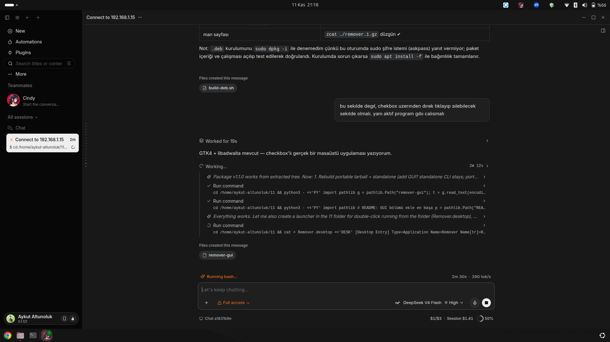

# remover

[English](README.md) · **Türkçe** · [中文](README.zh.md)

Ubuntu/Debian için küçük ve bağımlılıksız bir program kaldırıcı. Kurulu her şeyi listeler —
APT uygulamaları, Snap paketleri, Flatpak uygulamaları, Docker imajları, AppImage dosyaları ve
masaüstü kısayolları — sonra **onay kutularını işaretleyip seçtiklerinizi tek seferde kaldırmanızı** sağlar.



```
┌──────────────────────────────────────────────────────────────┐
│ ⟳   Remover                                                  │
│     114 öğe · 76 kaldırılabilir · 26.0 GB                    │
├──────────────────────────────────────────────────────────────┤
│ [ Program ara…            ]  [Tümünü seç]   [Temizle]        │
│ ▸ APT uygulamaları                                           │
│   ☐ zoom            Zoom Workplace                     APT   │
│   ☐ qoder-ide       Agentic Coding Platform            APT   │
│ ▸ Snap paketleri                                             │
│   ☐ android-studio  3.1 GB                            SNAP   │
│   ☐ snapd           snapd 2.77.1        korumalı ⛔    SNAP   │
├──────────────────────────────────────────────────────────────┤
│ 2 öğe seçili · ~1.7 GB              (⟳)  [Seçilenleri kaldır]│
└──────────────────────────────────────────────────────────────┘
```

## Neden

Linux'ta bir programı kaldırmak için önce onun `apt` mi, `snap` mi, `flatpak` mı, `docker` mı yoksa
tek başına duran bir `.AppImage` mi olduğunu hatırlamanız gerekir. `remover` tüm kaynakları tarar,
gerçek disk boyutlarıyla tek bir numaralı/işaretlenebilir liste gösterir ve her öğe için doğru komutu
tek onayla çalıştırır.

## Özellikler

- **GTK4 + libadwaita arayüzü** (`remover-gui`): onay kutulu liste, arama, tümünü seç/temizle,
  canlı boyut toplamı, komut günlüğü, tüm işlem için **tek** polkit/sudo penceresi.
- **Komut satırı** (`remover`): numaralı liste, aralık seçimi (`1,4,10-15`, `all`), `--dry-run`, `--json`.
- **Altı kaynak**: APT (elle kurulan uygulamalar), Snap, Flatpak, Docker imajları, AppImage, `.desktop` kısayolları.
- **Korumalı paketler** (`/etc/remover/remover.conf`): sistem, masaüstü ve altyapı paketleri
  (apache2, mysql, postgresql, php, docker, tailscale, cloudflared, git, node…) yanlışlıkla silinemez;
  listede kırmızı `korumalı` etiketiyle görünür ve kutusu pasiftir.
- **Runtime farkındalığı**: snap runtime'ları (`core22`, `gnome-4x`, `mesa-*`, `wine-platform*`)
  `runtime` etiketiyle işaretlenir — hangi snap'lerin onlara bağlı olduğunu görürsünüz.
- **Güvenli tasarım**: açık onay, dry-run modu, her çalıştırma için günlük
  (`~/.local/state/remover/`), kullanıcı verisine dokunmaz.
- **Python bağımlılığı yok**: yalnızca standart kütüphane (arayüz için Ubuntu'da hazır gelen PyGObject).

## Kurulum

### .deb paketi (önerilen)

```bash
# Releases bölümünden remover_1.1.0_all.deb indirin, sonra:
sudo apt install ./remover_1.1.0_all.deb
```

Bağımlılıklar kendiliğinden çözülür (`python3`, `python3-gi`, `gir1.2-gtk-4.0`, `gir1.2-adw-1`).
Paket şunları kurar: `/usr/bin/remover`, `/usr/bin/remover-gui`, `/etc/remover/remover.conf`,
man sayfası ve uygulama menüsü girdisi (**Remover**).

> İpucu: `.deb`'i ev dizininden kurarsanız apt `_apt kullanıcısı erişemiyor` uyarısı verebilir.
> Dosyayı `/tmp`'ye kopyalayıp oradan kurun.

### Taşınabilir (kurulumsuz)

```bash
tar -xzf remover-1.1.0-portable.tar.gz
./remover-1.1.0/run.sh        # arayüz açılır
./remover-1.1.0/remover list  # komut satırı
```

### Kaynaktan

```bash
git clone https://github.com/epixcomtr-rgb/remover.git
cd remover
sudo ./install.sh             # sistem geneli (+ menü kısayolu)
./install.sh --user           # ~/.local/bin, sudo gerekmez
./build-deb.sh                # .deb'i yeniden üretir
```

### Tek dosya

```bash
sh remover-standalone.sh list   # komut satırı tek dosyada, kurulum yok
```

## Kullanım

### Arayüz

```bash
remover-gui          # ya da uygulama menüsünden “Remover”
REMOVER_DRY_RUN=1 remover-gui   # hiçbir şey silmeden komutları göster
```

1. Kaldırmak istediğiniz programların kutularını işaretleyin.
2. **Seçilenleri kaldır** düğmesine basın.
3. Onay penceresinde **Kaldır**'a dokunun. Tüm işlem tek yetki penceresiyle yürür.

### Komut satırı

```bash
remover                 # etkileşimli: listele → seç → SIL yaz → kaldır
remover list            # sadece listele
remover list --json     # JSON çıktı
remover --dry-run       # planı göster, hiçbir şey silme
remover --no-autoremove # apt autoremove çalıştırma
remover --force-protected
```

Seçim sözdizimi: `3` · `1,4,9` · `10-15` · `all` · `q` (çıkış).
Onay için `SIL` yazılması zorunludur.

## Hangi komutlar çalışır?

| Kaynak | Tespit | Kaldırma komutu |
|---|---|---|
| APT | `apt-mark showmanual` (kütüphane/`-dev` elenir) | `apt-get purge -y --autoremove …` |
| Snap | `snap list` + gerçek dosya boyutu | `snap remove --purge …` |
| Flatpak | `flatpak list` | `flatpak uninstall -y …` |
| Docker | `docker images` | `docker rmi …` |
| AppImage | `~`, `~/Applications`, `~/İndirilenler`… | `rm -f …` |
| Kısayol | `~/.local/share/applications/*.desktop` | yalnızca `.desktop` dosyası silinir |

## Güvenlik notları

- Korumalı öğeler arayüzde pasif, komut satırında atlanır; tek aşma yolu `--force-protected`.
- `apt-get purge` paket yapılandırmasını da siler. Seçilen paket/imaj/dosya dışına dokunulmaz;
  kullanıcı verileri (ev dizini, veritabanları) asla silinmez.
- Her çalıştırma günlüğe yazılır: `~/.local/state/remover/remover-YYYYmmdd-HHMMSS.log`.
- Önce `--dry-run` / `REMOVER_DRY_RUN=1` ile planı gözden geçirin.

## Geliştirme

```
remover              CLI çekirdeği (tarama, plan, uygulama) — sadece stdlib
remover-gui          GTK4/libadwaita arayüzü, çekirdeği içe aktarır
remover.conf         varsayılan korumalı paketler
install.sh           kurulum (sistem veya --user)
build-deb.sh         remover_<sürüm>_all.deb üretir
uninstall.sh         kurulu dosyaları kaldırır
```

Arayüzü ekransız test etmek (CI uyumlu):

```bash
xvfb-run -a ./remover-gui --selftest
# selftest: 114 öğe, 114 satır · 114 öğe · 76 kaldırılabilir · 26.0 GB
# selftest: 2 kutu işaretlendi → seçili=2, özet='2 öğe seçili · ~1.7 GB', buton_aktif=True
# selftest: plan → yetkili=1 komut, kullanıcı=0 komut
```

## Lisans

MIT © 2026 Aykut Altunoluk
