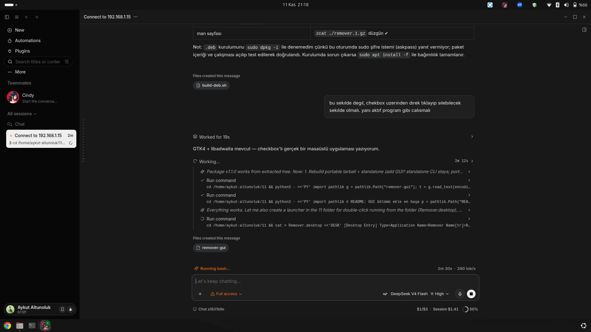

# remover

[English](README.md) · [Türkçe](README.tr.md) · **中文**

一个面向 Ubuntu/Debian 的轻量级、零依赖卸载工具。它会列出系统中安装的所有内容——
APT 应用、Snap 包、Flatpak 应用、Docker 镜像、AppImage 文件以及桌面快捷方式——
然后让你**勾选复选框，一次批量卸载所选项目**。



```
┌──────────────────────────────────────────────────────────────┐
│ ⟳   Remover                                                  │
│     114 项 · 76 项可卸载 · 26.0 GB                            │
├──────────────────────────────────────────────────────────────┤
│ [ 搜索程序…               ]  [全选]        [清除]            │
│ ▸ APT 应用                                                   │
│   ☐ zoom            Zoom Workplace                     APT   │
│   ☐ qoder-ide       Agentic Coding Platform            APT   │
│ ▸ Snap 包                                                    │
│   ☐ android-studio  3.1 GB                            SNAP   │
│   ☐ snapd           snapd 2.77.1        受保护 ⛔       SNAP   │
├──────────────────────────────────────────────────────────────┤
│ 已选择 2 项 · 约 1.7 GB             (⟳)  [卸载所选项目]       │
└──────────────────────────────────────────────────────────────┘
```

## 为什么需要它

在 Linux 上卸载软件前，你得先想起它来自 `apt`、`snap`、`flatpak`、`docker`，
还是一个随手放着的 `.AppImage`。`remover` 会扫描全部来源，用真实磁盘占用给出统一的
可勾选列表，并为每一项执行正确的卸载命令——只需确认一次。

## 功能

- **GTK4 + libadwaita 图形界面**（`remover-gui`）：复选框列表、搜索过滤、全选/清除、
  实时容量合计、命令日志面板，整批操作只弹一次 polkit/sudo 授权。
- **命令行**（`remover`）：带编号的列表、区间选择（`1,4,10-15`、`all`）、`--dry-run`、`--json`。
- **六种来源**：APT（手动安装的应用）、Snap、Flatpak、Docker 镜像、AppImage、`.desktop` 快捷方式。
- **受保护软件包**（`/etc/remover/remover.conf`）：系统、桌面与基础设施包
  （apache2、mysql、postgresql、php、docker、tailscale、cloudflared、git、node……）不会被误删，
  界面中显示红色 `受保护` 标签且复选框为禁用状态。
- **运行时识别**：snap 运行时（`core22`、`gnome-4x`、`mesa-*`、`wine-platform*`）标注为 `runtime`，
  让你知道哪些 snap 依赖它。
- **安全设计**：显式确认、dry-run 模式、每次运行写入日志（`~/.local/state/remover/`），
  绝不触碰用户数据。
- **无 Python 第三方依赖**：仅使用标准库（图形界面需要 Ubuntu 自带的 PyGObject）。

## 安装

### .deb 包（推荐）

```bash
# 从 Releases 下载 remover_1.1.0_all.deb，然后：
sudo apt install ./remover_1.1.0_all.deb
```

依赖会自动解决（`python3`、`python3-gi`、`gir1.2-gtk-4.0`、`gir1.2-adw-1`）。
包内包含：`/usr/bin/remover`、`/usr/bin/remover-gui`、`/etc/remover/remover.conf`、
man 手册页以及应用菜单项（**Remover**）。

> 提示：如果从主目录安装 `.deb`，apt 可能提示 `_apt 用户无法访问` 的提醒。
> 请先把文件复制到 `/tmp` 再安装。

### 免安装（便携版）

```bash
tar -xzf remover-1.1.0-portable.tar.gz
./remover-1.1.0/run.sh        # 打开图形界面
./remover-1.1.0/remover list  # 命令行
```

### 从源码安装

```bash
git clone https://github.com/epixcomtr-rgb/remover.git
cd remover
sudo ./install.sh             # 全系统安装（含菜单项）
./install.sh --user           # 安装到 ~/.local/bin，无需 sudo
./build-deb.sh                # 重新构建 .deb
```

### 单文件版

```bash
sh remover-standalone.sh list   # 单文件内嵌命令行版本，无需安装
```

## 使用

### 图形界面

```bash
remover-gui          # 或从应用菜单启动“Remover”
REMOVER_DRY_RUN=1 remover-gui   # 只显示命令，不删除任何内容
```

1. 勾选要卸载的程序。
2. 点击 **卸载所选项目**。
3. 在确认对话框中点击 **删除**。整批操作只需一次授权。

### 命令行

```bash
remover                 # 交互式：列出 → 选择 → 输入 SIL → 卸载
remover list            # 仅列出
remover list --json     # JSON 输出
remover --dry-run       # 只显示执行计划，不删除
remover --no-autoremove # 不执行 apt autoremove
remover --force-protected
```

选择语法：`3` · `1,4,9` · `10-15` · `all` · `q`（退出）。
确认时必须输入 `SIL`。

## 实际执行的命令

| 来源 | 识别方式 | 卸载命令 |
|---|---|---|
| APT | `apt-mark showmanual`（过滤库与 `-dev` 包） | `apt-get purge -y --autoremove …` |
| Snap | `snap list` + 真实文件大小 | `snap remove --purge …` |
| Flatpak | `flatpak list` | `flatpak uninstall -y …` |
| Docker | `docker images` | `docker rmi …` |
| AppImage | `~`、`~/Applications`、`~/下载` 等 | `rm -f …` |
| 快捷方式 | `~/.local/share/applications/*.desktop` | 仅删除 `.desktop` 文件 |

## 安全说明

- 受保护项在图形界面中不可勾选，命令行中会被跳过；唯一绕过方式是显式使用 `--force-protected`。
- `apt-get purge` 会同时删除软件包配置。除所选软件包、镜像与文件外不会触碰其他内容；
  用户数据（主目录、数据库）永不删除。
- 每次运行都会写日志：`~/.local/state/remover/remover-YYYYmmdd-HHMMSS.log`。
- 建议先用 `--dry-run` / `REMOVER_DRY_RUN=1` 检查执行计划。

## 开发

```
remover              CLI 核心（扫描、计划、执行）——仅标准库
remover-gui          GTK4/libadwaita 前端，导入 CLI 核心
remover.conf         默认受保护软件包列表
install.sh           安装脚本（系统级或 --user）
build-deb.sh         构建 remover_<版本>_all.deb
uninstall.sh         卸载已安装文件
```

无显示器环境下的界面自检（可用于 CI）：

```bash
xvfb-run -a ./remover-gui --selftest
# selftest: 114 项, 114 行 · 114 项 · 76 项可卸载 · 26.0 GB
# selftest: 勾选 2 个复选框 → 已选=2, 摘要='2 项已选 · ~1.7 GB', 按钮可用=True
# selftest: 计划 → 需授权命令=1, 用户命令=0
```

## 许可证

MIT © 2026 Aykut Altunoluk
